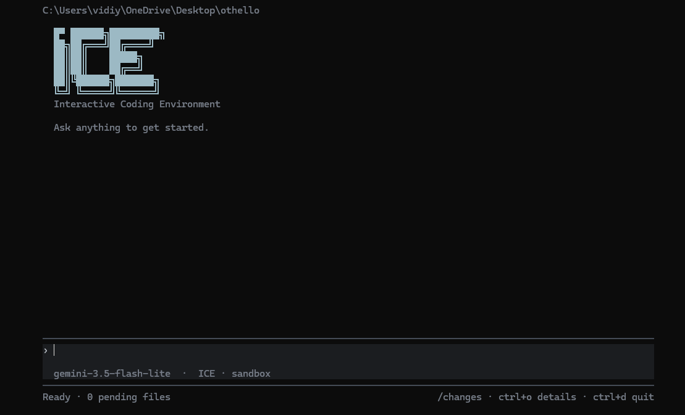

# ICE (Integrated Terminal Coding Agent)

**Interactive Coding Environment** — a Gemini-powered terminal coding agent with a Docker sandbox.

Describe a coding task in plain language. ICE can inspect a project, create and edit files, run checks, and show the resulting diffs. Work happens in an isolated copy of your project; you decide when to apply changes to your computer.




## Features

- **Streaming terminal interface** with Markdown responses, tool status, a thinking animation, scrollback, and clipboard shortcuts.
- **Gemini model selection** from Google's live API catalog, including an idle-session `/model` picker.
- **Session-only API-key onboarding** with hidden input when no key is configured.
- **Coding tools** for reading, writing, editing, searching, directory exploration, command execution, and planning.
- **Docker isolation** with a staged workspace, resource limits, and offline execution by default.
- **Approved dependency installation** with temporary container networking for npm or pip.
- **Change review** with old/new line numbers, individual edit history, and combined file diffs.
- **Explicit host apply** with conflict checks and recovery snapshots for unapplied changes.
- **Context pruning and loop detection** to manage long conversations and repeated tool calls.

## Project status

ICE is a working MVP developed and tested primarily on **Windows with Docker Desktop running Linux containers**. macOS, Linux-host integration, and other Unix systems are not yet verified as supported platforms. The sandbox itself runs Linux.

## Requirements

- Python **3.12** on the host.
- Docker Desktop running in **Linux-container mode**.
- A Gemini API key with access to a compatible text-generation model.
- Internet access for the initial image build, Gemini API requests, and any approved dependency installation.

You do not need Node.js or Git installed on Windows just for ICE's sandbox tools: the sandbox image includes Python, Node.js, npm, Git, and Bash. Running a generated project directly on Windows may require its own local runtime and dependencies.

## Quick start

### 1. Install ICE's Python dependencies

Clone or download this repository, then open PowerShell in its root directory:

```powershell
$iceRoot = (Get-Location).Path
python -m venv .venv
.\.venv\Scripts\python.exe -m pip install -r requirements.txt
```

### 2. Build the sandbox image

Start Docker Desktop and wait for the Linux engine to be ready. From the ICE repository:

```powershell
.\.venv\Scripts\python.exe -m sandbox build
```

The first build downloads the base image and installs the sandbox's tools. Rebuild after changes to ICE's container-side code.

### 3. Launch ICE from your project directory

The current working directory becomes the project workspace. Use a dedicated project folder, including an empty one if you are starting something new:

```powershell
Set-Location "C:\path\to\your-project"
& "$iceRoot\.venv\Scripts\python.exe" "$iceRoot\main.py"
```

Keep the same PowerShell session so `$iceRoot` is still defined, or replace it with your ICE installation path.

The included `ice.bat` currently contains a developer-specific path. Update it for your installation before using it as a global launcher; the explicit Python command above works without that launcher.

### 4. Configure Gemini

If no key is configured, ICE asks for your Gemini API key using hidden input. The entered key stays in memory for that process; ICE does not write it to disk or place it in chat messages or the sandbox.

ICE then fetches Gemini's model catalog. Choose a listed number or model ID. Known retired and specialised non-chat endpoints are filtered, and legacy choices are hidden by default. API listing does not guarantee that your account has quota or tool-calling access to every listed endpoint.

To avoid entering the key on later launches, configure `GEMINI_API_KEY` in your environment or the `.env` file alongside `config.py`:

```dotenv
GEMINI_API_KEY=your-gemini-api-key
```

Optionally set `GEMINI_MODEL_NAME` to an exact ID returned by the picker. It is a startup preference, checked against the live catalog. Model selections made in ICE are session-local.

Gemini API access and billing belong to the key you supply. ICE does not include a shared API key.

## Everyday workflow

```text
Build a small Sudoku game using HTML, CSS, and JavaScript.

/changes
/changes 1
/apply
```

1. Give ICE a task. It works on the sandbox copy, not the original host files.
2. Review the results with `/changes`. Use a file number to inspect its combined diff.
3. Run `/apply` to write staged changes into the original project directory.
4. Follow the local setup/start instructions where ICE can infer them from project manifests.

**If generated files are not in your PC folder yet, run `/apply`.** They remain staged inside Docker until you apply them.

Host edits made in your editor are checked before apply. ICE refuses to overwrite files that have changed since its baseline snapshot. Apply can create, replace, or delete project files. An unexpected filesystem error during apply can still produce a partial apply; ICE reports this and retains remaining changes as pending.

## Slash commands

| Command | Action |
| --- | --- |
| `/help` | Show commands and keyboard shortcuts. |
| `/model` | Fetch Gemini models and switch while idle, retaining conversation context and sandbox files. |
| `/install` | Detect the project dependency manager and request installation approval. |
| `/install npm` | Install from the current directory's `package.json`. |
| `/install pip` | Install from the current directory's `requirements.txt`. |
| `/install npm web` | Install dependencies for a subdirectory; `auto` or `pip` also work. |
| `/sandbox` | Show isolation status and pending file count. |
| `/changes` | List files changed during this session. |
| `/changes 1` | View file 1's combined session diff. |
| `/changes 1 2` | View file 1's second recorded edit. |
| `/changes all` | View combined diffs for all changed files. |
| `/chat` | Return from a review view to the chat. |
| `/expand` | Toggle details for the latest tool call. |
| `/copy` | Copy the chat to the clipboard. |
| `/apply` | Apply staged changes to the original host project. |
| `/exit`, `/quit`, or `exit` | End the session. |

Model selection and dependency installation are available when ICE is idle. `/details` is not an implemented alias; use `/expand`.

## Keyboard shortcuts

| Shortcut | Action |
| --- | --- |
| `Ctrl+O` | Expand/collapse the latest tool's details. |
| Mouse wheel or `PageUp` / `PageDown` | Scroll the transcript or diff viewer. |
| `Shift+Up` / `Shift+Down` | Scroll one line. |
| `Ctrl+Home` / `Ctrl+End` | Jump to the first/latest transcript content. |
| `Alt+Enter` | Insert a newline in the composer. |
| `Ctrl+V` or `Shift+Insert` | Paste from the system clipboard on Windows. |
| `Ctrl+A`, then `Ctrl+C` | Select and copy the composer text. |
| `F6` | Copy the latest assistant response. |
| `F7` | Copy the chat. |
| `Esc` | Leave a review/model view; otherwise stop active work. |
| `Ctrl+C` | Copy selected composer text, or interrupt work when no selection is active. |
| `Ctrl+D` | Quit. |

Reading earlier messages pauses automatic following. Use `Ctrl+End` to return to the latest output. Use ICE's clipboard controls when the full-screen terminal captures native mouse selection.

## Reviewing code changes

The changes viewer shows **diffs**, not complete files. The `OLD` and `NEW` columns give line numbers; `-` marks removed code and `+` marks added code. Unchanged lines appear as surrounding context.

File numbers stay stable within a session. Individual edits remain available even if later edits revert a file to its original content. History is session-local, and changes from before ICE started recording cannot be reconstructed by the viewer.

`Ctrl+O` is the shortcut for the latest tool result. `/changes` provides access to earlier file edits after other tools have run. Binary files are preserved during apply, but the text diff viewer is not a binary comparison tool.

## Dependencies: Docker versus Windows

ICE's sandbox has its own dependencies. It does not use your Windows `node_modules`, Python virtual environment, or globally installed packages.

Use `/install` or let ICE request the `install_dependencies` tool after creating a dependency manifest. Each installation asks for approval before granting **temporary general internet access**. Other tools pause, and the working volume is retained while ICE switches the session container online and then back offline. If offline restoration cannot be verified, the session stops instead of continuing online.

- **Node:** `npm ci` when a lockfile exists; otherwise `npm install`. Install scripts are disabled by default.
- **Python:** a fresh `/workspace/.venv`, populated from `requirements.txt`. Wheels only by default. Later Python commands automatically use this environment.
- **Packages needing scripts/builds:** ask ICE to request `allow_scripts=True`; the approval prompt discloses that choice. Additional compiler/system libraries may still be needed.

Temporary networking is not restricted to package registries and can reach services available through Docker's network. Ordinary commands stay offline. This workflow does not install packages on Windows.

After `/apply`, install dependencies locally to run the project on your laptop:

```powershell
# Node project
npm install
npm run dev   # If the project defines a dev script.
```

```powershell
# Python project
python -m venv .venv
.\.venv\Scripts\python.exe -m pip install -r requirements.txt
```

Linux dependency folders are not copied by `/apply`. Install locally once, and again when requirements change. Container dependencies are session-local and are not part of source recovery snapshots.

## Sandbox design

```text
Windows host                       Linux Docker sandbox
------------------------------     ------------------------------
Terminal UI and clipboard           Filtered project copy: /workspace
Gemini client and API key     --->  File tools and Bash commands
Approval and tool router            Python, Node.js, npm, Git
Change review and host apply        Project dependencies and checks
```

The CLI requires a working Docker engine and sandbox image. It never silently falls back to running agent commands on Windows.

Normal sandbox execution uses:

- A non-root user and a read-only system filesystem.
- A named Docker working volume, with no host bind mounts or Docker socket.
- Networking disabled by default.
- Dropped Linux capabilities and `no-new-privileges`.
- Limits of **1 GiB memory**, **2 CPUs**, and **128 processes**.
- A maximum ordinary command timeout of **300 seconds**; installation can request up to **900 seconds**.

Imports/exports are limited to **32 MiB and 5,000 files**. Common credentials, `.env` variants, `.git`, dependencies, caches, symlinks, and junctions are excluded from the initial copy. These filename filters cannot identify every secret someone might embed in source code.

Docker isolation and command inspection are complementary controls, not a guarantee against every runtime or kernel vulnerability. The current limits do not provide a total Docker-volume disk quota. See [sandbox documentation](sandbox/README.md) for execution limits, network transitions, and recovery details.

Stopping active execution kills the session container. Restart ICE to execute more tools after a stop; review and apply remain available. Approved installation recreates the offline session after normal success/failure, while cancellation stops the session.

## Recovering unapplied work

On normal exit, unapplied source changes are saved under the original project's:

```text
.ice-sandbox/sessions/<session-id>.json
```

Run recovery from the ICE installation directory:

```powershell
.\.venv\Scripts\python.exe -m sandbox recover "C:\path\to\project\.ice-sandbox\sessions\SESSION.json"
```

Recovery applies saved changes using the same path and conflict checks. If export failed, the manifest may reference a retained Docker volume and Docker is needed for recovery. Recovery snapshots contain project source and are excluded from Git by the included `.gitignore`.

## Project layout

```text
main.py          Application entry point
config.py        Environment and model preferences
agent/           Agent loop, typed events, loop detection
llm/             Gemini client, streaming, credentials, model catalog
tools/           File, search, planning, execution, installation tools
safety/          Command inspection and approval classification
sandbox/         Docker broker, worker, workspace sync and recovery
context/         Token tracking and stale-tool-output pruning
ui/              Terminal application, model picker, changes viewer, clipboard
utils/           Diff generation and supporting utilities
```

`postal-main/` is a local reference repository used for inspiration; it is not part of ICE's runtime architecture.

## Development checks

Examples of targeted offline checks:

```powershell
python -m unittest safety.test_regressions agent.test_loop_detection -v
python -m unittest ui.test_changes sandbox.test_ui -v
python -m unittest sandbox.test_dependencies -v
```

Docker integration tests are opt-in:

```powershell
$env:ICE_RUN_DOCKER_TESTS = '1'
python -m unittest sandbox.test_sandbox.DockerIntegrationTests -v
python -m unittest sandbox.test_dependencies.InstallDockerTests -v
Remove-Item Env:ICE_RUN_DOCKER_TESTS
```

They create temporary containers and workspaces. Dependency-install tests download small packages. Windows symlink tests may be skipped when the account cannot create symlinks. Test coverage does not imply that every Gemini model, project type, host OS, or failure path has been verified.

## Troubleshooting

| Problem | What to check |
| --- | --- |
| Files are missing from your PC folder | Review `/changes`, then run `/apply` in the same session. |
| Docker engine unavailable | Start Docker Desktop, select Linux containers, and wait for the engine. |
| Sandbox image missing or worker code outdated | Run `python -m sandbox build` from ICE's installation directory. |
| A model is unavailable or deprecated | Use the live startup picker or `/model`; listed models still depend on account access and quota. |
| An install fails because networking is disabled | Use `/install` instead of repeating an offline shell install. |
| A package needs an install script or source build | Ask for an install with explicit `allow_scripts=True` approval; check required toolchains. |
| A host file changed before `/apply` | Resolve the host/sandbox difference; ICE will not blindly overwrite the newer host file. |
| Clipboard selection behaves differently from a normal terminal | Use `F6`, `F7`, `/copy`, and `Ctrl+V`. |
| An API request returns a transient error such as 503 | The provider may be temporarily unavailable; automatic API recovery remains limited. |

## Current limitations

- Host integration is Windows-focused; other platforms need adaptation and verification.
- Files are staged until explicit apply; dependencies are not transferred to the host.
- Git metadata is excluded, so repository-history operations are unavailable unless initialized inside the sandbox.
- There is no full-file code editor or browser-preview workflow in the terminal UI.
- API retry/recovery and persistent conversation sessions remain limited.
- Model/tool compatibility and quota are not verified by catalog listing alone.

## Acknowledgments

ICE's terminal interface was inspired by the Postal reference project. Model access is provided through Google's Gemini API; the terminal UI uses Rich and prompt_toolkit, and execution isolation uses Docker.
